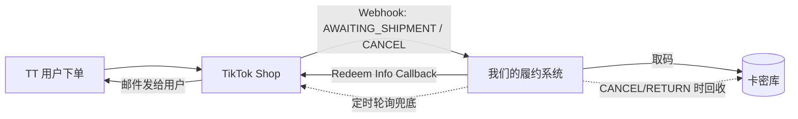
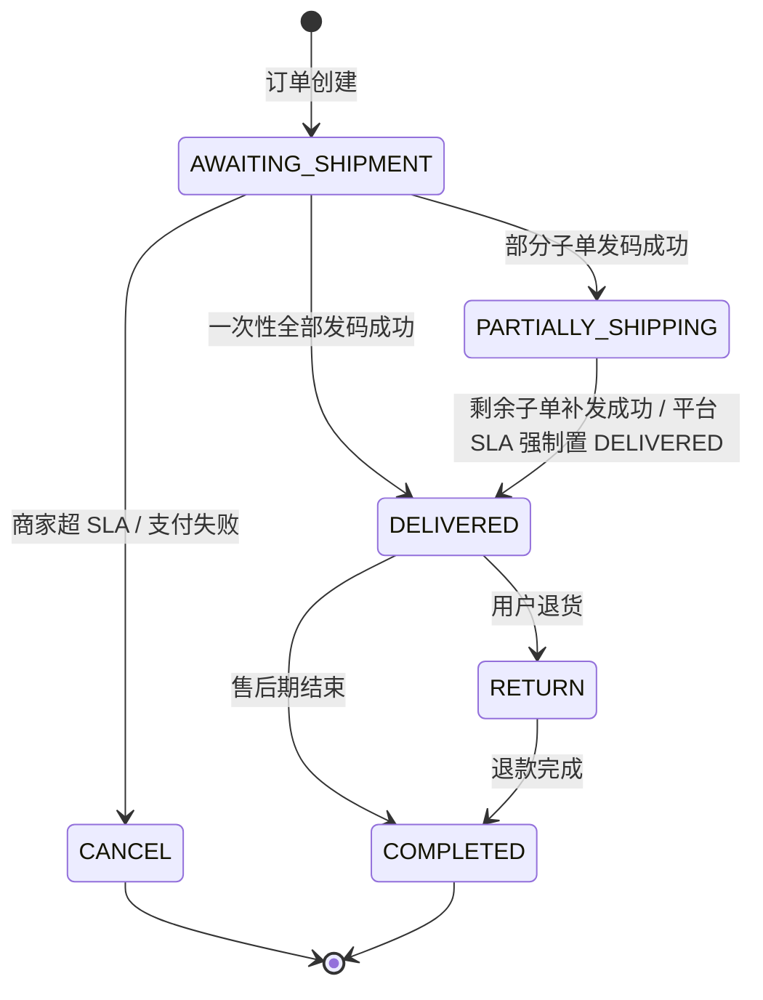

# TikTok Shop 虚拟商品履约系统 —— 开发计划

## 一、项目定位

- **业务背景**：TikTok Shop 刚开放虚拟类目，公司作为一代商家代销腾讯数字商品（美区 Virtual Goods 类目）
- **平台侧**：TT 全流程扶持入驻、加白、特批 SLA，销售链路不需要开发介入
- **开发侧的唯一硬任务**：完成**订单履约系统**（自动发码），没有这套系统用户下单后无法发卡密，订单会超 SLA 自动 CANCEL
- **当前资源**：TT 已提供测试账号（`seller_id` + `app_key` + `app_secret` + `refresh_token`），开发可立即启动，不依赖店铺审批

## 二、系统职责



核心做 5 件事：
1. **接 Webhook** 感知订单状态变更（AWAITING_SHIPMENT + CANCEL）
2. **拉订单列表/详情** 做兜底对账
3. **从卡密库取码**（并发安全、防重复发码）
4. **回传兑换信息**（Redeem Info Callback）完成"发货"
5. **码回收闭环**：CANCEL / RETURN / 平台 SLA 超时强制 DELIVERED 时，释放或作废对应码

## 三、技术栈（已确认）

- 语言：**Python 3.11 + FastAPI**
- DB：**PostgreSQL 15**
- Cache / 分布式锁：**Redis 7**
- 事件队列（履约 worker）：**arq**（基于 Redis，异步，支持重试/死信）
- 定时任务（对账 Job）：**APScheduler**（MVP 单实例，必须标注"不能多实例部署"）
- HTTP Client：**httpx（httpx.AsyncClient）**
- 日志：**structlog + Sentry**
- 加密：**cryptography.fernet**（token 和卡密敏感字段）
- 部署：**Docker + docker-compose + Caddy（自动 HTTPS）**

> 架构变更说明：原计划用 APScheduler 同时承担"发货"和"对账"，但 APScheduler 是定时器不是消息队列（无重试/死信/多实例语义）。webhook 触发的发货改用 arq，避免同步阻塞 5s 超时 + 解决多实例重复执行。

### TT API 双域名（Week 0 PoC 确认）

- `auth.tiktok-shops.com` —— 授权服务，不需要签名，token refresh / auth code 换 token 走这个
- `open-api.tiktokglobalshop.com` —— 业务 API（订单、发货、商品），**全部需要签名**

`.env` 要分别配 `TTS_AUTH_BASE` 和 `TTS_API_BASE`，`tts_client` 内部按 endpoint 类型路由到不同 host。

## 四、要集成的 4 个 TT Open API（强制）

| # | API | 用途 | Scope |
|---|---|---|---|
| 1 | [订单状态变更 Webhook](https://partner.tiktokshop.com/docv2/page/1-order-status-change) | 接收订单事件（仅 AWAITING_SHIPMENT / CANCEL 可用） | — |
| 2 | [获取订单列表](https://partner.tiktokshop.com/docv2/page/get-order-list-202309) | 兜底对账 | `seller.order.info` |
| 3 | [获取订单详情](https://partner.tiktokshop.com/docv2/page/get-order-detail-202507) | 拿单条完整信息 | `seller.order.info` |
| 4 | [兑换信息回传](https://partner.tiktokshop.com/docv2/page/redeem-info-callback-202601) | 发码"发货" | `seller.redeem_info.write` |

Onboarding 2.4.3 强调的两点必须遵守：
- **同一主订单的所有 `order_line_id` 必须合并在一次 Redeem Info Callback 里调用**，不要分开并发
- **Webhook 会丢**，必须加兜底对账

## 五、订单状态机（全量，已确认做全量）



关键分支（Onboarding 2.4.4.2 对应的每种触发条件）：

| 源状态 | 目标状态 | 触发条件 | Webhook | 我方动作 |
|---|---|---|---|---|
| AWAITING_SHIPMENT | DELIVERED | 全部发码成功（条件 3） | ❌ 需拉详情 | 收到 Redeem API 返回成功后，本地置 DELIVERED |
| AWAITING_SHIPMENT | PARTIALLY_SHIPPING | 部分子单发码 | ❌ | 本地置 PARTIALLY_SHIPPING，记录未发子单 |
| PARTIALLY_SHIPPING | DELIVERED | 剩余子单补发完 **或** 平台因 SLA 强制置 delivered（条件 4） | ❌ | 对账 Job 定期比对，平台置 delivered 后本地同步并释放未用码 |
| * | CANCEL | 商家超 SLA / 支付失败（条件 6） | ✅ | **释放所有已 locked 未 used 的码**（locked → free）|
| DELIVERED | RETURN | 用户发起退货 | ❌ 需拉详情 | 按业务规则：已发码按合同多数不可回收，置 `used` 保留审计；若合同允许回收则置 `recycled` |

## 六、项目结构（初版）

```
tt-shop/                                # 当前工作区根目录
├── docs/
│   ├── 虚拟类目商家Onboarding Guide.docx  # 已有
│   └── PLAN.md                         # 本计划文档副本
├── app/
│   ├── main.py                         # FastAPI 入口
│   ├── config.py                       # 配置（从 .env 读）
│   ├── auth/                           # OAuth + token 管理
│   │   ├── token_manager.py            # 含 Redis 互斥锁的 refresh
│   │   └── signer.py                   # TT API 签名算法
│   ├── api/                            # 对外接口
│   │   ├── webhook.py                  # 接收 TT webhook（1s 内返回）
│   │   └── admin.py                    # 重发码 / 状态查询 endpoint
│   ├── services/
│   │   ├── tts_client.py               # 4 个 API 封装 + 限流 + 错误分类重试
│   │   ├── fulfillment.py              # 发货核心（含订单级锁）
│   │   ├── code_inventory.py           # 卡密库操作
│   │   ├── state_machine.py            # 订单状态流转
│   │   └── reconciliation.py           # 对账 Job
│   ├── models/                         # SQLAlchemy 模型
│   ├── workers/                        # arq 任务定义
│   └── admin_cli/                      # 卡密导入脚本等
├── migrations/                         # Alembic DB 迁移
├── tests/
│   ├── unit/
│   └── integration/
├── docker-compose.yml
├── Dockerfile
├── Caddyfile                           # HTTPS + 反向代理
├── .env.example                        # 不含真实凭证
├── requirements.txt
└── README.md
```

## 七、数据库关键表设计

### 表清单

- `tts_shops` —— 授权店铺（主键 `shop_id`，含 `shop_cipher` / `region` / `seller_type` / `name`）。Week 0 PoC 发现：每次业务 API 必须带 shop_cipher，一个 App 可对多个店铺授权，启动时拉一次 `/authorization/202309/shops` 即可
- `tts_orders` —— 订单快照（主键 `order_id`，含 status / create_time / update_time / sla_deadline / shop_id）
- `tts_order_lines` —— 行订单（主键 `order_line_id`，关联 `order_id`，每条对应一个要发的码）
- `codes` —— 卡密库（见扩展字段）
- `sku_mapping` —— 腾讯 SKU ↔ TT `seller_sku` / `product_id` / `sku_id` 映射
- `webhook_events` —— 所有收到的 webhook 原始记录（幂等 + 审计）
- `fulfillment_log` —— 每次 Redeem 调用的请求/响应（排查 & 合规）
- `tts_tokens` —— access_token / refresh_token 存储（Fernet 加密）+ `version` 字段做乐观锁 + `access_token_expire_at`（Unix 绝对时间戳，**不是**剩余秒数）

### `codes` 表字段（扩展后）

| 字段 | 类型 | 说明 |
|---|---|---|
| `id` | bigserial | 主键 |
| `batch_id` | uuid | 导入批次，便于召回/审计 |
| `sku_id` | text | 内部 SKU，关联 `sku_mapping` |
| `face_value` | int | 面额（美分），不同面额的卡不能混发 |
| `code_encrypted` | bytea | Fernet 加密后的真实卡密 |
| `code_hash` | text | 卡密 SHA-256 哈希，用于去重和查找（带唯一索引） |
| `status` | enum | `free` / `locked` / `used` / `void` / `expired` / `recycled` |
| `order_line_id` | text nullable | 被哪个子单占用 |
| `locked_at` | timestamptz | 加锁时间（超过 N 分钟未 used 的自动解锁，防止僵尸锁） |
| `used_at` | timestamptz | Redeem 成功时间 |
| `expired_at` | timestamptz | 卡密自身有效期 |
| `operator` | text | 导入/操作人（审计） |
| `created_at` | timestamptz | |

### 关键约束

- `codes.status` 状态流转必须用**行级锁**（`SELECT ... FOR UPDATE`）原子切换，防止并发重复发同一张卡
- `codes.code_hash` 加唯一索引，防止同一张码重复导入
- `webhook_events` 以**幂等 key**（具体字段组合待 Week 0 抓包确认，预计为 `shop_id + order_id + status + event_timestamp`）加唯一索引
- 所有表加 `created_at` / `updated_at` 审计字段

## 八、开发里程碑（按周）

### Week 0（2~3 天 PoC，前置澄清）
- [ ] 用 curl/Postman 手工跑通一次 TT API 签名（验证签名算法）
- [ ] 抓一个真 webhook payload，确认幂等 key 字段
- [ ] 和直客对齐：每个 API 的 QPS 限制 / webhook 来源 IP 段 / webhook 重试策略
- [ ] 买域名（因为第 2 周要报 TT）

### Week 1：跑通最小闭环（用测试账号本地开发）
- [ ] 项目脚手架 + Docker 起 Postgres/Redis
- [ ] `signer.py` + unit test（用 Week 0 的 golden sample）
- [ ] `token_manager`：用 refresh_token 换 access_token + **Redis 分布式锁**包住 refresh
- [ ] `tts_client`：封装 4 个 API + 令牌桶限流
- [ ] 用测试账号跑通"拉订单列表"和"Redeem Info Callback"（硬编码假卡密）

### Week 2：Webhook + 卡密库 + staging 上线
- [ ] Webhook 接收器：验签 + 幂等入库 + **push 到 arq 队列后立即 200**（<1s）
- [ ] 用 ngrok 本地联调
- [ ] 卡密库表 + 批量导入脚本 + 取码（`FOR UPDATE`）+ 解锁 Job（超时 locked → free）
- [ ] 发货 Worker（arq）：订单级 Redis 锁 → 拉详情 → 合并 order_line_id → Redeem → 落日志
- [ ] CANCEL webhook 处理：释放锁定的码
- [ ] **极简 staging 部署**（服务器 + 域名 + HTTPS 打通，业务逻辑可继续开发），**立刻把 webhook URL 报给 TT**

### Week 3：稳定性 + 全量状态机 + 真实联调
- [ ] 对账 Job（APScheduler，每 5 分钟，单实例锁）+ 补发漏单
- [ ] 平台 SLA 强制 DELIVERED 的识别和本地同步 + 码回收
- [ ] 重发码 endpoint（Case 2 用）
- [ ] 错误分类重试 + 死信 + 飞书告警
- [ ] 结构化日志 + Sentry + 业务指标
- [ ] 卡密库 off-site 备份脚本 + Postgres 每日快照
- [ ] 按 Onboarding 2.6.2 跑真实订单联调（4 个场景全覆盖）

### 店铺开好之后（不阻塞）
- [ ] Partner Center 注册开发者（邮箱与 Seller Center 一致、绑 AM）
- [ ] 创建 Custom App，拿到正式 `app_key` / `app_secret`
- [ ] 店铺授权 App → 拿到生产 `refresh_token`
- [ ] 在生产 App 里重新配 webhook URL（**不只换 key，回调 URL 也要重配**）
- [ ] 替换 `.env` 上线

## 九、基础设施

### 1. 域名
- 买 `.com` 域名（Cloudflare Registrar / Namecheap，$10-12/年）
- 规划 `api.<yourdomain>.com` / `admin.<yourdomain>.com`
- DNS 套 Cloudflare 免费代理（WAF + 防 DDoS）
- 用**公司邮箱**注册
- **第 1 周就买**（第 2 周要报 TT，早报早排期）

### 2. 服务器
- 推荐 AWS Lightsail us-east-1（2C 2G 60G SSD / 3T 流量 / ~$10-12/月，自带静态 IP）
- 备选：腾讯云国际 / 阿里云国际（美东或新加坡）
- **不要放国内、不要用家用/VPS 小厂商**
- 有公司云账号直接用
- **Postgres 每日快照**（Lightsail 内置，$2/月）
- **卡密库 off-site 备份**（S3 或同云商对象存储，加密 + 版本化）

### 3. HTTPS
- Let's Encrypt 免费（Caddy 自动续期）
- TT webhook 必须 HTTPS

### 4. 报备 webhook URL
- **第 2 周末就报**（不等全部写完），URL：`https://api.<yourdomain>.com/webhook/tts`
- TT 研发在行业 tcc 里配置 prefix，不配就收不到
- 拿到 TT webhook 来源 IP 段后，Cloudflare WAF 限制只有 TT 机房能访问

### 5. 成本预算（第一年）
- 域名：~$12
- Lightsail + 快照：~$150
- Sentry / 监控：$0（免费档）
- **合计约 $160/年**

## 十、并发安全三道防线（重点补充）

本节是"**P0 必须落地的并发安全设计**"，整个系统的稳定性都靠它们：

### 防线 1：Token 刷新互斥锁
- TT `refresh_token` 是**一次性**的：刷新一次就失效，多实例/多 worker 同时发现 token 过期会并发调 refresh，导致其中 N-1 个拿到 "refresh_token invalid"，系统直接掉线
- 方案：`token_manager.get_access_token()` 在发现 token 临近过期时（剩余 < 10min），先 `SET NX EX 30 token_refresh_lock:{app_key}`，拿到锁的实例 refresh 并把新 token 写回 DB，没拿到锁的实例轮询等 1s 后重读 DB

### 防线 2：订单级分布式锁
- **场景**：webhook 和对账 Job 几乎同时命中同一订单，都去调 Redeem，可能导致重复发码 / 多锁码
- 方案：`fulfillment.process(order_id)` 入口先 `SET NX EX 60 order_lock:{order_id}`，拿不到锁直接跳过（另一路会处理）
- 锁的续期：长订单（拉详情慢）用看门狗线程每 20s 续期一次

### 防线 3：数据库行锁取码
- 取码 SQL 模板：
  ```sql
  SELECT id, code_encrypted FROM codes
  WHERE sku_id = $1 AND face_value = $2 AND status = 'free'
  ORDER BY id LIMIT 1
  FOR UPDATE SKIP LOCKED;  -- SKIP LOCKED 避免等锁
  
  UPDATE codes SET status='locked', order_line_id=$3, locked_at=NOW()
  WHERE id = $id;
  ```
- `FOR UPDATE SKIP LOCKED` 保证高并发下不同事务拿到不同码，不会阻塞

## 十一、错误分类与重试策略（重点补充）

| 错误类别 | 例子 | 策略 |
|---|---|---|
| 网络错误 / 5xx / 超时 | ConnectionError / 502 / 504 | 指数退避重试（1s/4s/16s），最多 3 次，超过进死信 + 告警 |
| TT 429 限流 | `code: 429` | 读 `Retry-After` header，退避后重试，计入限流指标 |
| 签名错误 / 401 / 403 | `invalid_signature` / `invalid_token` | **不重试**（重试也会失败）；401 触发一次 token 刷新后重试 1 次，还失败就告警 |
| 业务幂等成功 | `order_line_id already redeemed` | **视为成功**（幂等），本地状态直接推进 |
| 业务不可恢复 | `order not found` / `sku mismatch` | **不重试**，写死信 + 人工处理 |
| 卡密库存不足 | 取码返回 0 行 | 立即告警（飞书 + Sentry），订单留在 AWAITING_SHIPMENT，人工补货后对账 Job 自动兜底 |

实现建议：`tts_client` 里每个 API 调用返回 `(ok, result_or_error)` 元组，error 带分类 tag，由 arq task 根据 tag 决定是否 raise 让 arq 重试。

## 十二、安全与合规

- `.env` 绝不提交 git，`.gitignore` 必须加
- 测试账号凭证（docx 里明文）**不再外传**；开发完成后问 TT 是否需要轮换
- access_token / refresh_token / 卡密 `code_encrypted` 全部 Fernet 加密存储
- **Fernet 主密钥**：MVP 阶段存 `.env`，后续迁移到 AWS Secrets Manager / Vault
- 卡密是高价值数字资产：
  - 所有取码操作有 `fulfillment_log`（请求、响应、操作人）
  - 卡密导入要记 `operator`（谁导入的）+ `batch_id`；建议双人复核
  - off-site 备份 + 定期校验
  - 合规日志保留 3~7 年（和业务/法务确认）
- Cloudflare WAF 把 webhook 接口限制在 TT 机房 IP 段
- 后台接口（重发码、卡密查询）加 admin token + IP 白名单

## 十三、与 TT 的协作清单

| 事项 | 谁推进 | 时机 |
|---|---|---|
| 报 webhook 域名 prefix 给 TT | 开发 → 直客 | **第 2 周末**（提前到 staging 上线时）|
| 确认每个 API 的 QPS 限制 | 开发 → 直客 | Week 0 |
| 确认 webhook 幂等 key / 重试策略 / 来源 IP 段 | 开发 → 直客 | Week 0 ~ Week 2 |
| 确认 Redirect URL 格式 | 开发 → 直客 | 创建正式 App 前 |
| 真实订单联调排期 | 开发 → 直客 | 第 3 周 |
| 生产 `app_key` / `secret` / `refresh_token` 切换 | 运营 + 开发 | 店铺开好后 |

## 十四、已确认的业务决策（2026-04-21）

- **卡密交付形式**：✅ **批量文件导入（库存模式）**。`codes` 表 + `FOR UPDATE SKIP LOCKED` 架构成立，不做实时代理。
- **第一版范围**：✅ **全量状态机**（含 CANCEL / RETURN / 平台 SLA 强制 DELIVERED / 码回收），一次做全，不分期。

## 十四点五、Week 0 PoC 实测得到的 TT API 细节（2026-04-22）

Week 0 用测试账号（`app_key=your_app_key` / `seller_id=7496219619042560602`）实际跑通 3 个接口后，确认了文档里没明说的实现细节：

| # | 细节 | 对实现的影响 |
|---|---|---|
| 1 | 授权服务独立域名 `auth.tiktok-shops.com`，业务 API 在 `open-api.tiktokglobalshop.com` | `tts_client` 按 endpoint 路由；`.env` 分两个 base |
| 2 | v2 API (202309+) 的 `access_token` 放 **header `x-tts-access-token`**，不放 query string，也不参与签名 | `signer.EXCLUDED_PARAMS` 已排除 `access_token`，header 统一在 client 层注入 |
| 3 | 所有业务 API 必须带 `shop_cipher`（query 参数，参与签名）| 启动时拉一次 `/authorization/202309/shops`，cache 到 `tts_shops` 表；多 shop 时按 order 的 shop_id 查询 |
| 4 | `access_token_expire_in` 返回的是 **Unix 绝对时间戳**（如 `1777449213` 代表 2026-04-28 过期），**不是 OAuth2 标准的剩余秒数** | token 过期判断用 `if now >= expire_at`；DB 列命名用 `expire_at` 避免歧义 |
| 5 | 签名算法：`HMAC-SHA256(key=app_secret, msg=app_secret + path + sorted(params) + body + app_secret)`，输出 hex 小写 | 已实现 + 21 条单测 + 2 条 live golden 固化 |
| 6 | 测试账号所在店铺是**美区跨境商家**（region=US / seller_type=CROSS_BORDER / seller_base_region=CN）| 业务逻辑要考虑跨境时区和退款流程 |
| 7 | 测试账号 scope 全开：`seller.redeem_info.write` / `seller.order.info` / `seller.logistics` / `seller.product.basic` / `seller.product.write` / `seller.return_refund.basic` / `seller.authorization.info` | 生产 App 申请 scope 时对齐此清单 |
| 8 | 国内开发机即便挂代理，Clash 默认规则集没覆盖 `tiktok-shops.com` → 被 GFW 劫持返回上海公安局伪造证书 | 开发机 `.env` 显式配 `TTS_HTTP_PROXY` + Clash 自定义规则；生产服务器**买美东/新加坡云主机裸直连**彻底规避 |

### 已 live 验证的 golden 签名（`tests/unit/test_signer.py::TestLiveGolden`）

| request_id | endpoint | 作为回归基准的意义 |
|---|---|---|
| `...791C` | GET `/authorization/202309/shops` | 验证纯 GET、无 body 的签名 |
| `...B60F` | POST `/order/202309/orders/search` | 验证有 JSON body 的签名（body 拼接位置）|

**任何对 `signer.py` 的改动都必须让这两个 case 继续通过**，否则服务端会拒请求。

## 十五、已识别的风险清单（落地应对 → 见对应章节）

| # | 风险 | 影响 | 应对 | 章节 |
|---|---|---|---|---|
| 1 | TT 签名算法不熟 → Week 1 卡壳 | 进度 | Week 0 先用 curl 打通并写 golden test | §八 Week 0 |
| 2 | Webhook 幂等 key 字段不确定 | 重复发码 | Week 0 抓真实 payload 确认，之后在 `webhook_events` 加唯一索引 | §七 |
| 3 | refresh_token 并发刷新作废 | 系统掉线 | Redis 分布式锁 | §十 防线 1 |
| 4 | webhook 和对账 Job 竞争同订单 | 重复发码 / 码丢失 | 订单级 Redis 锁 | §十 防线 2 |
| 5 | webhook 同步处理超 5s | TT 判失败重复推送 | arq 异步化，webhook 只入队 | §三, §八 Week 2 |
| 6 | APScheduler 多实例重复跑 Job | 重复对账 | MVP 单实例部署 + DB singleton 锁；文档里标注 | §三 |
| 7 | 盲目重试签名错误/业务错误 | 资源浪费、误告警 | 错误分类表 | §十一 |
| 8 | TT API QPS 限流被打爆 | 订单积压 | Week 0 问限额 + 令牌桶限流 | §十一, §八 Week 0 |
| 9 | 报备 webhook URL 太晚 → 联调拖期 | 工期 | 第 2 周就报，不等功能完善 | §八 Week 2 |
| 10 | CANCEL / RETURN 不处理 | 卡密库"假用完"、已发码无审计 | 全量状态机 + 码回收闭环 | §五, §八 Week 2/3 |
| 11 | 平台 SLA 强制 DELIVERED 未同步 | 本地与 TT 状态漂移 | 对账 Job 检测 delivered 后同步并回收未用码 | §五, §八 Week 3 |
| 12 | `codes` 字段不够（面额/有效期/批次） | 混发、无法召回、无审计 | 扩展字段表 | §七 |
| 13 | 卡密库单点 / 无备份 | 数字资产丢失 | Postgres 每日快照 + off-site 备份 | §九 |
| 14 | 生产切换只换 key，忘了换 webhook URL | 上线后收不到 webhook | `prod_cutover` todo 明确写出 | §八 |
| 15 | 大促时 `FOR UPDATE` 取码变串行 | 性能瓶颈 | 用 `SKIP LOCKED` + 监控，MVP 足够，后续按需迁 Redis 原子操作 | §十 防线 3 |
| 16 | 卡密库低水位无预警 | 订单积压 + 超时取消 | 业务指标 + 告警 | §八 `metrics` |
| 17 | 国内开发机直连 TT 美区 API 会被 GFW 劫持（返回上海公安局伪造证书）| 开发机需全程挂代理，代理掉线会用伪造证书继续跑；生产机必须买美东/新加坡云主机**裸直连**，不依赖 VPN | 开发机：`.env` 显式配 `TTS_HTTP_PROXY`，脚本 preflight 自检证书真实性<br>生产机：买境外云主机，代码里不允许配代理 | §八 Week 0, §九 |

## 十六、仍需用户确认的信息（不阻塞启动）

- 首批上架的 **SKU 数量** 和 **单日预估订单量**（决定是否现在就上水平扩展）
- 团队里 **谁负责部署和长期运维**（影响运维复杂度）
- **退款场景**：已发出的码按合同是否允许回收？（决定 RETURN 状态下码的终态是 `recycled` 还是 `used`）
- 合规日志保留时长（法务/业务确认，决定是否需要冷存储）

## 十七、交付物

- 可运行的 Docker 化服务（`docker-compose up` 一键起）
- 完整的 API 对接代码 + 单元测试 + 关键集成测试
- 部署文档（服务器、域名、HTTPS、环境变量、上线步骤、回滚预案）
- 运维手册（卡密导入流程、补发流程、告警处理 SOP、退款/回收 SOP）
- 联调记录（每个 API 的请求响应样例，以及 4 个联调场景的执行报告）
